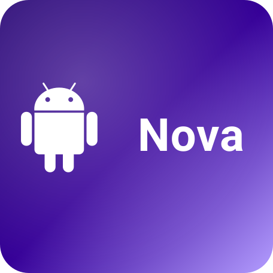

# Nova

Короче, это интерпретатор языка программирования, который живёт прямо в браузере. Открываешь один HTML-файл — и у тебя редактор, консоль, REPL и подсветка синтаксиса. Никаких `npm install`, никаких сборок, вообще ничего ставить не надо. Кстати сделано для андройда так что я не планировал вам поднасрать своей иконкой :)

<p align="center">
  
</p>

## Что это за язык

Язык получился такой… джаваскрипт, но проще. Есть `let`, `const`, `fn`, `if`, `while`, `for`, массивы, объекты, замыкания, рекурсия. Переменные можно называть по-русски — `let привет = "мир"` работает как надо. Точку с запятой можно ставить, можно не ставить, кто как привык.

Внутри всё по-честному: сначала лексер режет текст на токены, потом парсер (обычный Pratt) собирает из них дерево, потом интерпретатор это дерево обходит и выполняет. Никакой магии, всё в одном файле, всё читается.

## Зачем

Зачем я это сделал — хз, захотелось. Вроде как pet-проект, но получилось вполне юзабельно: можно писать циклы, функции, объекты, даже счётчик на замыканиях собрать. В REPL внизу можно вводить выражения по одной строчке и смотреть, что выходит — переменные между строками сохраняются.

## Чего тут нет

Из очевидного: это не продакшн-язык. Тут нет модулей, нет нормальной стандартной библиотеки, нет обработки ошибок через `try/catch`. Но если хочется поиграться или показать ребёнку, что такое переменная и цикл — самое то. Плюс весь код на виду, можно залезть и посмотреть, как оно устроено.

# Nova Tryout

<p align="center">
  <b>Для тех кому лень качать или хочется попробовать...</b>
</p>

<p align="center">
  <a href="https://elsan97.github.io/Nova/"><b>NOVA TRYOUT (полноценная работа)</b></a>
</p>

## Как запустить

Скачал файл, открыл в браузере, написал:

```nova
print("привет");
